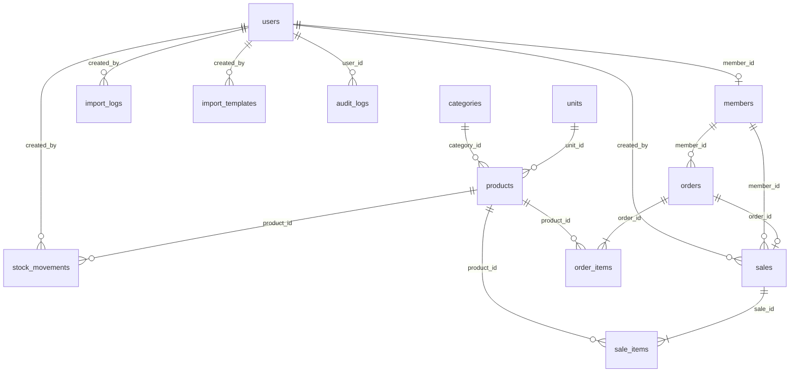

# Desain Database & Kamus Data — Sistem Informasi Koperasi

Dokumen ini merupakan panduan teknis model data PostgreSQL yang dikelola melalui Prisma ORM (`prisma/schema.prisma`).

---

## 1. Diagram Relasi Entitas (ERD)

---

## 2. Kamus Data Entitas

### 2.1 `users`
Menyimpan akun pengguna sistem untuk keperluan autentikasi dan RBAC.
- `id`: String (cuid, Primary Key)
- `username`: String (Unique)
- `email`: String (Unique)
- `password_hash`: String (bcrypt hash)
- `role`: Enum (`ADMIN`, `KASIR`, `ANGGOTA`)
- `member_id`: String (Nullable, Foreign Key ke `members.id`)
- `is_active`: Boolean (Default: true)
- `created_at`, `updated_at`: Timestamp

### 2.2 `members`
Menyimpan profil anggota koperasi.
- `id`: String (cuid, PK)
- `member_no`: String (Unique, format `ANG-XXXX`)
- `name`: String
- `nik`: String (Nullable, Unique)
- `address`, `phone`, `email`: String (Nullable)
- `joined_at`: Timestamp (Default: now)
- `status`: Enum (`AKTIF`, `NONAKTIF`)
- `deleted_at`: Timestamp (Nullable untuk *soft delete*)

### 2.3 `categories` & `units`
Master klasifikasi barang dan satuan takaran/kemasan.
- `categories`: `id`, `name` (Unique)
- `units`: `id`, `name` (Unique)

### 2.4 `suppliers`
Master data pemasok barang koperasi.
- `id`, `name`, `phone`, `address`

### 2.5 `products`
Katalog barang dagangan koperasi.
- `id`: String (cuid, PK)
- `sku`: String (Unique, format `BRG-XXXX`)
- `name`: String
- `category_id`: FK ke `categories.id` (onDelete: Restrict)
- `unit_id`: FK ke `units.id` (onDelete: Restrict)
- `cost_price`: Int (Harga beli dalam integer rupiah)
- `sell_price`: Int (Harga jual dalam integer rupiah)
- `stock`: Int (Stok fisik saat ini)
- `reserved_stock`: Int (Stok yang dicadangkan untuk pesanan aktif berstatus `DIKONFIRMASI`)
- `min_stock`: Int (Batas minimum peringatan stok menipis)
- `is_active`: Boolean
- `deleted_at`: Timestamp (Nullable untuk *soft delete*)

### 2.6 `stock_movements`
Audit trail seluruh pergerakan stok barang secara atomik.
- `id`: String (cuid, PK)
- `product_id`: FK ke `products.id` (onDelete: Cascade)
- `type`: Enum (`IMPORT`, `PURCHASE`, `SALE`, `ORDER_FULFILLED`, `ADJUSTMENT`, `RETURN`)
- `qty_change`: Int (Positif = barang masuk; Negatif = barang keluar)
- `stock_before`: Int
- `stock_after`: Int
- `ref_type`: String (Nullable, e.g. "ORDER", "SALE", "ADJUSTMENT")
- `ref_id`: String (Nullable, ID referensi transaksi)
- `note`: String (Alasan penyesuaian atau keterangan faktur)
- `created_by`: FK ke `users.id`

### 2.7 `orders` & `order_items`
Pemesanan barang oleh anggota koperasi secara online.
- `orders.order_no`: String (Unique, format `ORD-YYYYMMDD-XXXX`)
- `orders.status`: Enum (`DIAJUKAN`, `DIKONFIRMASI`, `DISIAPKAN`, `SIAP_DIAMBIL`, `SELESAI`, `DIBATALKAN`, `DITOLAK`)
- `orders.total`: Int (Total belanja dalam rupiah)
- `order_items`: Menyimpan rincian item, kuantitas (`qty`), dan `unit_price` (harga jual saat dipesan).

### 2.8 `sales` & `sale_items`
Transaksi penjualan kasir (POS) maupun pesanan anggota yang telah selesai diambil.
- `sales.sale_no`: String (Unique, format `SLS-YYYYMMDD-XXXX`)
- `sales.payment_method`: Enum (`TUNAI`, `TRANSFER`, `BON`, `LAINNYA`)
- `sales.payment_status`: Enum (`LUNAS`, `BELUM_LUNAS`)
- `sales.status`: Enum (`COMPLETED`, `CANCELLED`)
- `sales.sold_at`: Timestamp (Dasar laporan periodik)
- `sale_items.cost_price`: Int (Snapshot harga beli saat barang terjual untuk menghitung laba kotor akurat di `reportService`).

### 2.9 `import_logs` & `import_templates`
Pencatatan riwayat impor data Excel sistem lama dan penyimpanan template mapping kolom.
- `import_logs`: `type`, `filename`, `total_rows`, `success_rows`, `failed_rows`, `status`, `mapping_json`.
- `import_templates`: `type`, `name`, `mapping_json`.

### 2.10 `audit_logs`
Pencatatan jejak audit aktivitas penting pengguna (login, aksi CRUD data master, perubahan stok, dsb).
- `user_id`, `action`, `entity`, `entity_id`, `detail_json`, `created_at`.

---

## 3. Indeks Performa Utama

Untuk mendukung Acceptance Criteria query dasbor < 2 detik dan laporan tahunan < 5 detik:
1. `sales(sold_at)` — Mempercepat query agregasi periodik penjualan.
2. `sale_items(product_id)` & `sale_items(sale_id)` — Mempercepat analisis barang terlaris dan join rincian penjualan.
3. `orders(member_id, status)` — Mempercepat daftar riwayat pesanan anggota dan filter status.
4. `stock_movements(product_id, created_at)` — Mempercepat rekap audit kartu stok barang.
5. `products(stock)`, `products(is_active)`, `products(deleted_at)` — Mempercepat filter stok menipis dan katalog barang aktif.

---

## 4. Aturan Perubahan Schema (Bagi Seluruh Tim)

1. **Wajib Lewat Review P1:** Tidak ada anggota tim (P2–P5) yang boleh memodifikasi file `prisma/schema.prisma` di branch masing-masing tanpa koordinasi dengan Tech Lead (P1).
2. **Jangan Mengubah Tipe Uang:** Seluruh nilai rupiah tetap `Int`. Dilarang mengganti ke `Float` atau `Decimal`.
3. **Migrasi Terkelola:** Setiap perubahan schema wajib menghasilkan file migrasi baru di folder `prisma/migrations/`.
